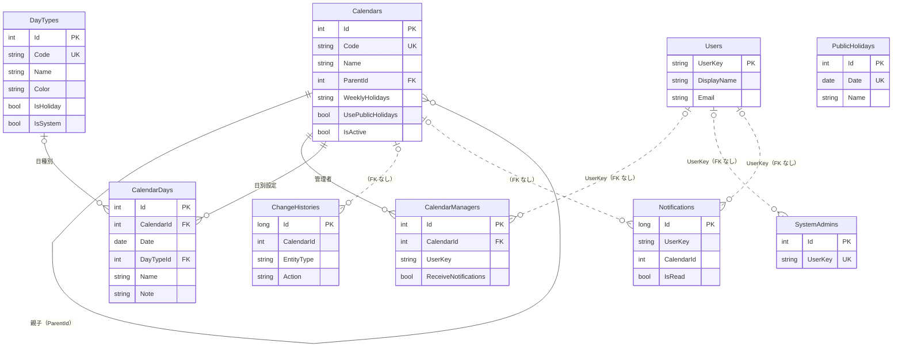

# 06. DB 設計

本書は EF Core のモデル（`src/ShareMaster.Server/Data/Entities/Entities.cs`・`Data/ShareMasterDbContext.cs`）および
マイグレーション（`Data/Migrations/Sqlite`・`Data/Migrations/SqlServer`）から作成している。
**モデルを変更したら本書も更新すること。**

## 1. 方針

| 項目 | 内容 |
| --- | --- |
| DB 製品 | 当面 SQLite。将来 SQL Server / Azure SQL Database へ移行（`Database:Provider` = `Sqlite` \| `SqlServer`） |
| スキーマ管理 | EF Core マイグレーション（コードファースト）。DB 製品ごとに別フォルダで管理し、モデル変更時は両方に追加 |
| スキーマ適用 | 起動時に自動適用（`Database:MigrateOnStartup`、既定 `true`） |
| DB 固有機能 | 使わない（トリガー・ストアド・ビュー・DB 側の既定値なし。整合性はアプリと FK・一意制約で担保） |
| 主キー | 原則サロゲートキー（自動採番）。利用者マスタ（`Users`）のみ `UserKey` を自然キーとする |
| 外部連携キー | カレンダー・日種別は `Code`（一意）で識別する。ID は環境間で一致を保証しない（ただしデータ移行時は ID を保持） |
| 削除 | カレンダーは論理削除（`IsActive`）。日別設定・管理者などの明細は物理削除し、変更履歴に内容を残す |
| 監査 | 主要テーブルは作成・更新日時／者を保持。全データ変更は `ChangeHistories` に記録（`HistoryWriter.Add`） |
| 日時 | `DateTimeOffset`（UTC で保存）。日付のみの項目は `DateOnly` |
| 利用者の識別 | `UserKey` = Entra ID の `preferred_username`（無ければ `oid`）を **小文字化** した値。開発時は `X-Dev-User` の値 |
| 文字列 | 長さは EF の `HasMaxLength` で定義。SQL Server では `nvarchar` |

### 型の対応

| .NET 型 | SQLite | SQL Server | 備考 |
| --- | --- | --- | --- |
| `int` | INTEGER | int | |
| `long` | INTEGER | bigint | |
| `bool` | INTEGER（0/1） | bit | |
| `string`（長さ指定） | TEXT | nvarchar(n) | |
| `string`（長さ無指定） | TEXT | nvarchar(max) | JSON 項目のみ |
| `DateOnly` | TEXT（`yyyy-MM-dd`） | date | |
| `DateTimeOffset` | INTEGER | datetimeoffset | SQLite は並べ替え・比較のため `DateTimeOffsetToBinaryConverter` で数値化 |

## 2. ER 図

実線は FK 制約あり、点線は FK 制約なしの論理的な関連。
`ChangeHistories`・`Notifications` はカレンダーや利用者が削除・変更されても残す必要があるため、あえて FK を張っていない。

## 3. テーブル一覧

| No | テーブル | 論理名 | 区分 | 概要 |
| --- | --- | --- | --- | --- |
| 1 | `Calendars` | カレンダー | マスタ | 親子関係を持つカレンダー。子は親の設定を継承・上書きする |
| 2 | `CalendarManagers` | カレンダー管理者 | マスタ | カレンダーの編集権限者。親カレンダー変更通知の宛先 |
| 3 | `CalendarDays` | カレンダー日別設定 | トランザクション | 親（または曜日・祝日）からの差分のみを保持 |
| 4 | `DayTypes` | 日種別 | マスタ | 休日の種類と表示色 |
| 5 | `PublicHolidays` | 祝日 | マスタ | 全カレンダー共通の祝日 |
| 6 | `Users` | 利用者 | マスタ | ログイン時に自動登録。管理者選択の候補 |
| 7 | `SystemAdmins` | システム管理者 | マスタ | カレンダー追加・削除、日種別・祝日の管理が可能な利用者 |
| 8 | `ChangeHistories` | 変更履歴 | 履歴 | 全データ変更の記録 |
| 9 | `Notifications` | 通知 | トランザクション | アプリ内通知 |

## 4. テーブル定義

凡例：PK＝主キー、FK＝外部キー、UK＝一意、必須＝NOT NULL。型は SQL Server 表記。

### 4.1 Calendars（カレンダー）

| 列 | 論理名 | 型 | 必須 | キー | 説明 |
| --- | --- | --- | --- | --- | --- |
| Id | ID | int | ○ | PK | 自動採番 |
| Code | コード | nvarchar(50) | ○ | UK | 外部連携用 |
| Name | 名称 | nvarchar(100) | ○ | | |
| Description | 説明 | nvarchar(1000) | | | |
| ParentId | 親カレンダー ID | int | | FK → Calendars.Id | null はルート |
| SortOrder | 表示順 | int | ○ | | |
| WeeklyHolidays | 定休曜日 | nvarchar(20) | | | `"0,6"` 形式（0=日曜〜6=土曜）。null は親を継承。空文字は定休なし |
| UsePublicHolidays | 祝日を休日とする | bit | | | null は親を継承 |
| IsActive | 有効 | bit | ○ | | false は論理削除済み |
| CreatedAt | 作成日時 | datetimeoffset | ○ | | |
| CreatedBy | 作成者 | nvarchar(256) | ○ | | UserKey |
| UpdatedAt | 更新日時 | datetimeoffset | ○ | | |
| UpdatedBy | 更新者 | nvarchar(256) | ○ | | UserKey |

- インデックス：`IX_Calendars_Code`（一意）、`IX_Calendars_ParentId`
- FK：`FK_Calendars_Calendars_ParentId`（削除時 Restrict）
- 祖先まで遡っても null の場合の既定値：定休曜日 `"0,6"`（土日）、祝日を休日とする `true`（`Domain/CalendarResolver.cs`）。
- 子を持つカレンダーは削除不可（アプリ側でチェック）。

### 4.2 CalendarManagers（カレンダー管理者）

| 列 | 論理名 | 型 | 必須 | キー | 説明 |
| --- | --- | --- | --- | --- | --- |
| Id | ID | int | ○ | PK | 自動採番 |
| CalendarId | カレンダー ID | int | ○ | FK → Calendars.Id | |
| UserKey | 利用者キー | nvarchar(256) | ○ | | 小文字 |
| DisplayName | 表示名 | nvarchar(200) | ○ | | 登録時点の表示名 |
| ReceiveNotifications | 通知を受け取る | bit | ○ | | 親カレンダー変更時の通知対象 |

- インデックス：`IX_CalendarManagers_CalendarId_UserKey`（一意）
- FK：`FK_CalendarManagers_Calendars_CalendarId`（削除時 Cascade）

### 4.3 CalendarDays（カレンダー日別設定）

| 列 | 論理名 | 型 | 必須 | キー | 説明 |
| --- | --- | --- | --- | --- | --- |
| Id | ID | int | ○ | PK | 自動採番 |
| CalendarId | カレンダー ID | int | ○ | FK → Calendars.Id | |
| Date | 日付 | date | ○ | | |
| DayTypeId | 日種別 ID | int | | FK → DayTypes.Id | null は区分を上書きせず特記事項のみ |
| Name | 名称 | nvarchar(100) | | | 休日名など表示用 |
| Note | 特記事項 | nvarchar(1000) | | | |
| CreatedAt | 作成日時 | datetimeoffset | ○ | | |
| CreatedBy | 作成者 | nvarchar(256) | ○ | | |
| UpdatedAt | 更新日時 | datetimeoffset | ○ | | |
| UpdatedBy | 更新者 | nvarchar(256) | ○ | | |

- インデックス：`IX_CalendarDays_CalendarId_Date`（一意）、`IX_CalendarDays_DayTypeId`
- FK：`FK_CalendarDays_Calendars_CalendarId`（Cascade）、`FK_CalendarDays_DayTypes_DayTypeId`（Restrict。使用中の日種別は削除不可）
- 継承後の最終的な休日判定は保存しない。都度 `CalendarResolver` で解決する。

### 4.4 DayTypes（日種別）

| 列 | 論理名 | 型 | 必須 | キー | 説明 |
| --- | --- | --- | --- | --- | --- |
| Id | ID | int | ○ | PK | 自動採番 |
| Code | コード | nvarchar(50) | ○ | UK | |
| Name | 名称 | nvarchar(100) | ○ | | |
| Color | 表示色 | nvarchar(9) | ○ | | `#RRGGBB` |
| IsHoliday | 休日扱い | bit | ○ | | |
| SortOrder | 表示順 | int | ○ | | |
| IsSystem | システム予約 | bit | ○ | | true は削除不可 |

- インデックス：`IX_DayTypes_Code`（一意）
- 初期データ（`DbInitializer.SeedMasterAsync`、テーブルが空のときのみ）：

| Code | Name | Color | IsHoliday | SortOrder | IsSystem |
| --- | --- | --- | --- | --- | --- |
| WORKDAY | 稼働日 | #607D8B | false | 10 | true |
| HALFDAY | 半日稼働 | #F9A825 | false | 20 | false |
| COMPANY | 会社休日 | #2E7D32 | true | 30 | false |
| SUMMER | 夏季休暇 | #EF6C00 | true | 40 | false |
| NEWYEAR | 年末年始 | #00838F | true | 50 | false |
| SPECIAL | 特別休日 | #AD1457 | true | 60 | false |

### 4.5 PublicHolidays（祝日）

| 列 | 論理名 | 型 | 必須 | キー | 説明 |
| --- | --- | --- | --- | --- | --- |
| Id | ID | int | ○ | PK | 自動採番 |
| Date | 日付 | date | ○ | UK | |
| Name | 名称 | nvarchar(100) | ○ | | |

- インデックス：`IX_PublicHolidays_Date`（一意）
- 初期データ：テーブルが空のとき、前年〜翌々年を `JapaneseHolidayCalculator` で生成。

### 4.6 Users（利用者）

| 列 | 論理名 | 型 | 必須 | キー | 説明 |
| --- | --- | --- | --- | --- | --- |
| UserKey | 利用者キー | nvarchar(256) | ○ | PK | 小文字 |
| DisplayName | 表示名 | nvarchar(200) | ○ | | |
| Email | メールアドレス | nvarchar(256) | | | |
| LastAccessedAt | 最終アクセス日時 | datetimeoffset | ○ | | |

- `/api/me` 呼び出し時に登録・更新する。

### 4.7 SystemAdmins（システム管理者）

| 列 | 論理名 | 型 | 必須 | キー | 説明 |
| --- | --- | --- | --- | --- | --- |
| Id | ID | int | ○ | PK | 自動採番 |
| UserKey | 利用者キー | nvarchar(256) | ○ | UK | 小文字 |
| DisplayName | 表示名 | nvarchar(200) | ○ | | |
| CreatedAt | 登録日時 | datetimeoffset | ○ | | |
| CreatedBy | 登録者 | nvarchar(256) | ○ | | 初期投入は `system` |

- インデックス：`IX_SystemAdmins_UserKey`（一意）
- 初期データ：テーブルが空のとき `Auth:BootstrapAdmins` を登録（開発モードで未設定なら最初の開発ユーザー）。

### 4.8 ChangeHistories（変更履歴）

| 列 | 論理名 | 型 | 必須 | キー | 説明 |
| --- | --- | --- | --- | --- | --- |
| Id | ID | bigint | ○ | PK | 自動採番 |
| CalendarId | カレンダー ID | int | | | 関連カレンダー（FK なし）。共通マスタの変更は null |
| EntityType | 対象種別 | nvarchar(50) | ○ | | `Calendar` / `CalendarDay` / `DayType` / `PublicHoliday` / `SystemAdmin` |
| EntityKey | 対象キー | nvarchar(100) | ○ | | 対象を特定する値 |
| Action | 操作 | nvarchar(20) | ○ | | `Create` / `Update` / `Delete` |
| Summary | 概要 | nvarchar(1000) | ○ | | 1000 文字で切り詰め |
| BeforeJson | 変更前 | nvarchar(max) | | | JSON |
| AfterJson | 変更後 | nvarchar(max) | | | JSON |
| ChangedBy | 変更者 | nvarchar(256) | ○ | | UserKey |
| ChangedByName | 変更者名 | nvarchar(200) | ○ | | |
| ChangedAt | 変更日時 | datetimeoffset | ○ | | |

- インデックス：`IX_ChangeHistories_CalendarId_ChangedAt`、`IX_ChangeHistories_ChangedAt`
- 追記のみ（更新・削除しない）。

### 4.9 Notifications（通知）

| 列 | 論理名 | 型 | 必須 | キー | 説明 |
| --- | --- | --- | --- | --- | --- |
| Id | ID | bigint | ○ | PK | 自動採番 |
| UserKey | 宛先利用者キー | nvarchar(256) | ○ | | 小文字（FK なし） |
| CalendarId | カレンダー ID | int | | | 関連カレンダー（FK なし） |
| Title | 件名 | nvarchar(200) | ○ | | |
| Message | 本文 | nvarchar(2000) | ○ | | |
| LinkUrl | リンク先 | nvarchar(500) | | | 画面内の相対 URL |
| IsRead | 既読 | bit | ○ | | |
| CreatedAt | 作成日時 | datetimeoffset | ○ | | |

- インデックス：`IX_Notifications_UserKey_IsRead_CreatedAt`
- 親カレンダーの休日に影響する変更時、`NotificationService.NotifyDescendantManagersAsync` が子孫カレンダーの管理者（`ReceiveNotifications = true`）宛に作成する。

## 5. データ移行（SQLite → SQL Server）

`ShareMaster.Server.dll copy-data --from "Data Source=..."`（`Data/DataTransfer.cs`）で、移行先にテーブルを作成した後、ID を保持したまま全件複写する。
FK の依存関係に合わせて次の順で投入する（カレンダーは親から順）。

1. DayTypes
2. PublicHolidays
3. Users
4. SystemAdmins
5. Calendars（階層の浅い順）
6. CalendarManagers
7. CalendarDays
8. ChangeHistories / Notifications

テーブルを追加した場合は `DataTransfer.CopyAsync` と本書の両方を更新すること。
